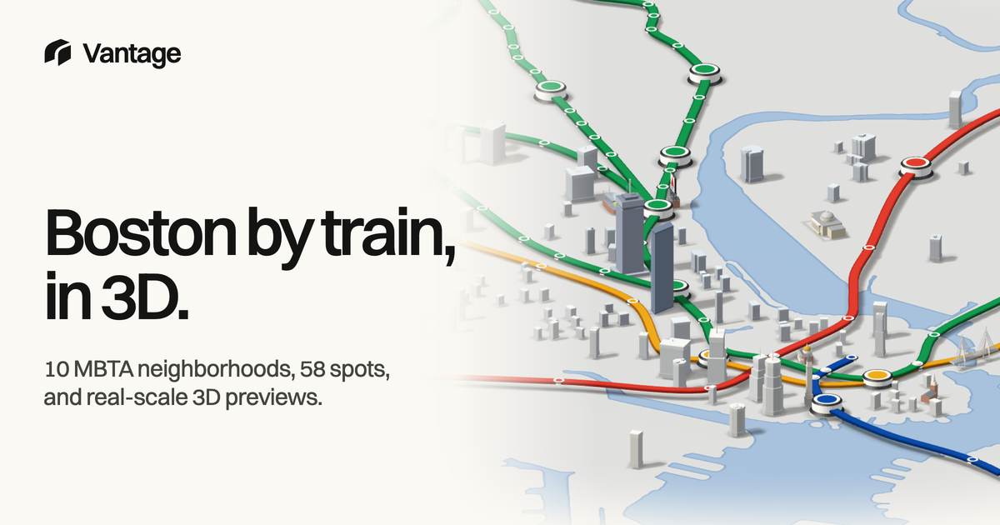
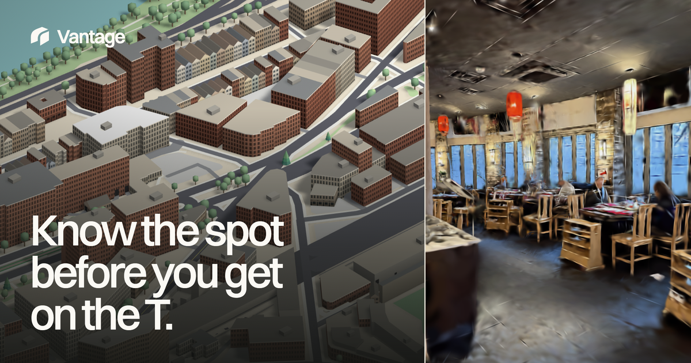
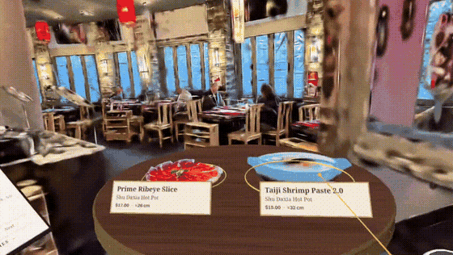
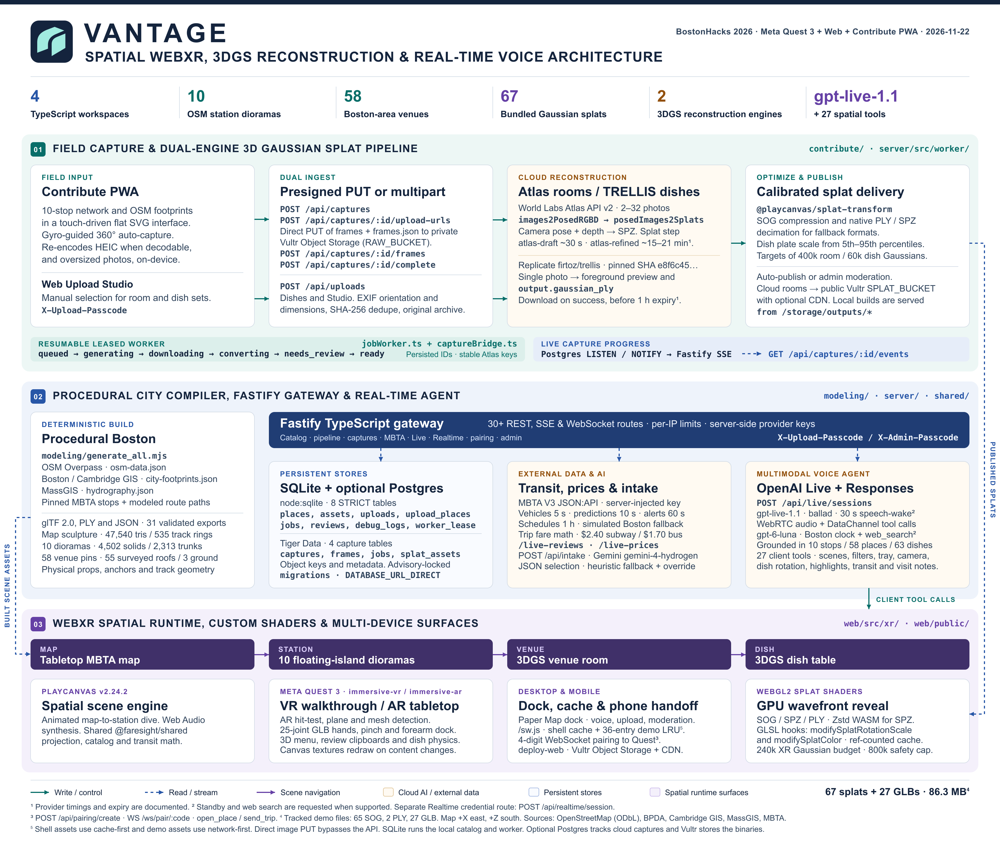
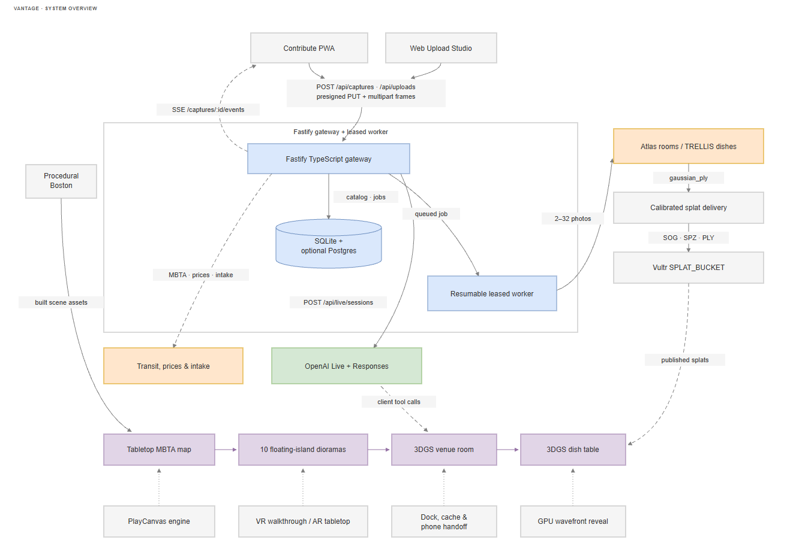
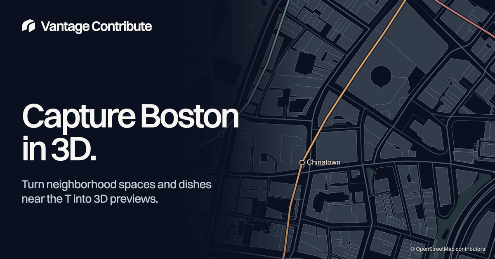

<div align="center">
  
  <h1>Vantage</h1>
  <p><strong>Try Boston before you ride.</strong></p>
  <p>
    Explore Boston restaurants, study cafes, and hangouts by MBTA stop in WebXR on Meta Quest 3 or in any browser.
    Filter by craving, group size, and total cost with T fare included, then step inside scanned rooms and inspect dishes at real scale.
  </p>
  <p>
    <a href="#visual-tour">Visual tour</a> &middot;
    <a href="#architecture">Architecture</a> &middot;
    <a href="#3d-capture-and-voice-pipeline">3DGS &amp; Voice</a> &middot;
    <a href="#vantage-contribute">Contribute</a> &middot;
    <a href="#quick-start">Quick start</a> &middot;
    <a href="#operations-and-deployment">Deploy</a>
  </p>
</div>

<p align="center">
  
</p>

Built for BostonHacks 2026, Vantage pairs a procedural 3D Boston transit map and ten OpenStreetMap station dioramas with real 3D Gaussian Splat interiors, actual-size dishes, live MBTA arrivals, and a WebRTC voice guide.

---

## Visual tour

<table>
  <tr>
    <td width="54%" valign="top">
      
      <p><sub><strong>Map to neighborhood to dining room.</strong> Jump from the tabletop MBTA sculpture into ten floating-island station blocks, then step directly inside a venue's 3D Gaussian Splat.</sub></p>
    </td>
    <td width="46%" valign="top">
      
      <p><sub><strong>Real-scale 3D dishes.</strong> Inspect plates on the virtual table or over Meta Quest 3 passthrough, calibrated from each splat's 5th to 95th percentile bounds.</sub></p>
    </td>
  </tr>
</table>

| Metric | Shipped in this repo |
| :--- | :--- |
| Coverage | 10 MBTA neighborhoods, 58 Boston-area venues, 63 menu dishes |
| Bundled 3D assets | 67 Gaussian splats (`.sog` and `.ply`), 27 `.glb` models, 31 validated procedural exports |
| 3DGS engines | World Labs Atlas API v2 (rooms) and pinned Replicate `firtoz/trellis` (dishes) |
| Voice agent | OpenAI `gpt-live-1.1` (`ballad` voice) + `gpt-6-luna` Responses delegation + 27 spatial tools |
| Surfaces | Meta Quest 3 (`immersive-vr` and `immersive-ar`), desktop/mobile web, Contribute capture PWA |

---

## Four-scene spatial flow

Vantage runs as one PlayCanvas v2 + WebGL2 application that moves through four views without reloading.

1. **Tabletop MBTA map (`boston-map-sculpture.glb`)** opens on a grounded sculpture of Boston with an inlaid Charles River, street grid, stacked Green (B/C/D/E), Red, Orange, and Blue tubes, live train capsules, and raised drums at ten explorable stations.
2. **Floating-island station dioramas (`segment-place-*.glb`)** load ten OpenStreetMap city blocks on sculpted islands of turf, earth, and rock: BU Central, Packard's Corner, Kenmore, Harvard Square, Chinatown, Haymarket, Copley, Aquarium, Central Square, and Coolidge Corner. Rooftop flags show total cost with MBTA fare (`$2.40` subway, `$1.70` bus) included.
3. **3DGS venue rooms** bring visitors inside scanned dining rooms with a custom GLSL wavefront materialization shader (`SplatLoader.ts` and `JarvisReveal.ts`), physical 3D menus, and review clipboards.
4. **3DGS dish tables and AR placement** place dishes at real size on the virtual table or onto a physical table in Meta Quest 3 `immersive-ar` passthrough, driven by 25-joint matte WebXR hand tracking and controllers.

---

## Architecture

<p align="center">
  
</p>

<details>
<summary>High-level system flow overview</summary>
<br />
<p align="center">
  
</p>
</details>

### Workspaces

| Package | Path | Responsibility |
| :--- | :--- | :--- |
| Procedural 3D compiler | `modeling/` | Deterministic glTF 2.0 (`.glb`) and binary `.ply` generators built from OpenStreetMap Overpass, Boston/Cambridge GIS, MassGIS hydrography, and GTFS shapes. Produces `boston-map-sculpture.glb`, 10 station dioramas (`modeling/segment-island.mjs`), `mbta-train-capsule.glb`, `table-pedestal.glb`, physical VR props, and 2 demo 3DGS `.ply` assets (study cafe and `18 cm` matcha tiramisu). |
| `@faresight/shared` | `shared/` | Shared TypeScript domain types, flat-earth Boston sculpture projection, MBTA fare constants (`$2.40` subway / `$1.70` bus), precomputed ride times, trip estimate math, and the 27-tool GPT Live schema. |
| `@faresight/server` | `server/` | Node + TypeScript + Fastify gateway, built-in SQLite (`node:sqlite`, STRICT tables), optional TigerData Postgres and Vultr Object Storage bridge, resumable job worker, cached MBTA V3 proxy, OpenAI Live broker, and WebSocket headset pairing. |
| `@faresight/web` | `web/` | PlayCanvas v2 + WebXR (`immersive-vr` and `immersive-ar`) four-scene runtime, animated map-to-station dive, 3D canvas panels, procedural Web Audio synthesizer, Paper Map 2D dock with spring motion, Upload & Pipeline Studio, Moderation, Pairing, and offline Service Worker (`/sw.js`). |
| `@faresight/contribute` | `contribute/` | Zero-3D mobile capture PWA served from `contribute.<domain>` (or `/contribute/`), built with flat touch-driven SVG maps, guided 360-degree room scanning, two-photo dish scanning, and live job tracking. |

---

## 3D capture and voice pipeline

Jobs run through a persistent, resumable worker (`queued -> generating -> downloading -> converting -> needs_review -> ready`) coordinated by SQLite leases and stable idempotency keys.

| Stage | Engine & routes | Behavior |
| :--- | :--- | :--- |
| Upload & AI intake | `POST /api/uploads`, `POST /api/intake`, Google Gemini (`gemini-4-hydrogen`) | Parses EXIF orientation and dimensions, deduplicates by SHA-256, archives originals, and selects reference photos as structured JSON with manual override and heuristic fallback. |
| Room 3DGS | [World Labs Atlas API v2](https://docs.atlas.worldlabs.ai/) (`POST /api/jobs`) | Takes 2 to 32 overlapping photos, estimates poses and depth (`images2PosedRGBD`), and builds an `.spz` splat (`posedImages2Splats`) in `atlas-draft` (about 30 seconds) or `atlas-refined` (about 15 to 21 minutes). Persists both operation IDs for safe retries. |
| Dish 3DGS | Replicate `firtoz/trellis` (`e8f6c45206993f297372f5436b90350817bd9b4a0d52d2a76df50c1c8afa2b3c`) | Accepts single or multi-photo dish sets, downloads `output.gaussian_ply` and the foreground preview before Replicate's 1-hour expiry, turns dishes upright (`dishOrientation.ts`), and judges real physical size (`dishMeasure.ts`). |
| Compression & scale | `@playcanvas/splat-transform`, `splatDecimate.ts` | Decimates and compresses splats to `.sog` while retaining `.spz` or `.ply` originals. Falls back to viewer-compatible `.spz` or normalized `.ply` when the CLI is absent. Calibrates dish scale from 5th to 95th percentile bounds. |

### Voice guide, live transit, and headset pairing

`POST /api/live/sessions` and `GET /api/live/status` broker the app's WebRTC connection to OpenAI `gpt-live-1.1` (`ballad` voice by default). A `gpt-6-luna` Responses backend handles catalog and transit queries and runs 27 client tools for scene navigation, budget and craving filters, dish rotation, comparison trays, and review clipboards. A separate `POST /api/realtime/session` route mints short-lived `gpt-realtime` credentials with the same voice; both endpoints read `OPENAI_API_KEY` on the server.

`GET /api/mbta/{vehicles,predictions,alerts,schedules,trip}` proxies the MBTA V3 API with server-side key injection and per-feed cache TTLs (5s for vehicles, 10s for predictions, 60s for alerts, 1h for schedules), falling back to a Boston transit simulation when `MBTA_API_KEY` is unset. For headset handoff, `POST /api/pairing/create` and `WS /ws/pair/:code` link a phone and Meta Quest 3 over a four-digit session code.

<details>
<summary>Server API reference</summary>

| Domain | Endpoints |
| :--- | :--- |
| Catalog & enrichment | `GET /api/stops`, `GET /api/restaurants`, `GET /api/restaurants/:id`, `GET /api/restaurants/:id/manifest`, `GET /api/restaurants/:id/live-reviews`, `GET /api/restaurants/:id/live-prices` |
| Upload & 3DGS jobs | `POST /api/uploads`, `POST /api/intake`, `POST /api/jobs`, `GET /api/jobs`, `GET /api/jobs/:id`, `POST /api/jobs/:id/retry`, `GET /api/assets/:id`, `POST /api/assets/:id/publish` |
| Cloud room captures | `POST /api/captures`, `GET /api/captures`, `POST /api/captures/:id/upload-urls`, `POST /api/captures/:id/frames`, `POST /api/captures/:id/complete`, `GET /api/captures/:id`, `GET /api/captures/:id/events` (SSE), `DELETE /api/captures/:id` |
| Transit, voice & pairing | `GET /api/mbta/{vehicles,predictions,alerts,schedules,trip}`, `GET /api/live/status`, `POST /api/live/sessions`, `POST /api/realtime/session`, `POST /api/pairing/create`, `WS /ws/pair/:code` |
| Community & admin | `POST /api/restaurants/:id/reviews`, `GET/POST /api/admin/moderation`, `POST/GET /api/debug/logs`, `GET /api/health` |

</details>

---

## Vantage Contribute

<p align="center">
  
</p>

Vantage Contribute (`contribute/`) is a mobile-first web app for capturing the photos behind the 3D rooms and dishes. It loads no 3D engine: the network map and neighborhood footprints draw as touch-driven SVG maps derived from the same geometry as the 3D dioramas. Tapping any of the ten MBTA nodes opens that neighborhood's OpenStreetMap footprints with brass venue pins synced to a swipeable card rail.

### Capture flows on a phone

For a full room, the guided 360-degree scan places target dots around the contributor; turning in place and holding steady on each dot takes the shot automatically, while a round compass tracks what remains behind them. Because mobile browsers gate camera and motion sensors behind TLS, run `pnpm --filter @faresight/contribute dev:https` to serve `https://<your-LAN-IP>:5181` with a self-signed certificate.

For a dish, the two-photo scan opens the camera so the contributor taps the shutter twice from two different sides (for a flat plate, once at a slant and once from above). Nothing needs lining up and no motion sensors are used, because TRELLIS resolves the two views itself. The older angle-guided dish flow remains available through "Guide me to each angle instead", and contributors can always upload 2 to 32 room photos or dish photos from their library (HEIC and oversized images are re-encoded on the phone first).

### Place photos, reviews, and access

Each venue card leads with a freely licensed photo. Running `pnpm --filter @faresight/contribute photos` searches Wikimedia Commons and Openverse and writes author, license, and source fields to `contribute/src/data/place-photos.json` while keeping existing hand-picked entries intact. Entries without a direct photo are marked `nearby` and labeled "Area photo", while historical entries display a `tag` such as "Earlier location" or "Older photo". Contributors can read and submit 1-to-5 star reviews (published after admin approval in the main app) and track live pipeline progress under "My scans".

Uploads authenticate with `CONTRIBUTOR_PASSCODE` stored once per device, or can be opened without a code by setting `OPEN_UPLOADS=1` on the server (admin routes always require `ADMIN_PASSCODE`). After regenerating 3D models, run `pnpm --filter @faresight/contribute data` to rebuild `contribute/src/data/` from `modeling/output/` and `modeling/osm-data.json`.

---

## Quick start

```bash
pnpm install
cp .env.example .env      # Optional: add OPENAI_API_KEY, GEMINI_API_KEY, WLT_API_KEY, REPLICATE_API_TOKEN, MBTA_API_KEY
pnpm assets:sync          # Sync modeling/output/* into web/public/assets-demo/
pnpm dev                  # Fastify (:3001) + Web (:5173) + Contribute (:5180 HTTP, :5181 HTTPS)
```

| Surface | Local URL | Notes |
| :--- | :--- | :--- |
| Vantage web app | `http://localhost:5173` | Use HTTPS for Meta Quest 3 WebXR |
| Vantage landing page | `http://localhost:5173/intro.html` | Scroll-driven 3D tour from map to dining room |
| Contribute (desktop) | `http://contribute.localhost:5180` | Proxies `/api` and `/storage` to `:3001` |
| Contribute (phone) | `https://<your-LAN-IP>:5181` | Accept the self-signed cert once; HTTP blocks camera sensors and simulates the scan |

### Configuration notes

- Without API keys (`PIPELINE_MODE=auto`), the Upload 3D studio runs a labeled demo simulation through all pipeline stages (`Queued -> Generating -> Downloading -> Converting -> Needs review -> Ready`) and publishes into the live manifest.
- Atlas project keys need `tasks.create`, `operations.read`, `assets.create`, and `assets.read`. Set `WLT_API_KEY` or `WORLDLABS_API_KEY`, and optionally `WLT_API_BASE_URL` for a custom Atlas v2 endpoint.
- Keep a current `@playcanvas/splat-transform` CLI on the server's `PATH` so Atlas room previews stay near the 100,000-Gaussian conversion target; large raw SPZs can exceed the viewer's safety limit.
- Set `ADMIN_PASSCODE` to enable moderation routes, and `AUTO_PUBLISH=false` to hold completed builds for review.

---

## Operations and deployment

<details>
<summary><strong>Capture storage: Tiger Data Postgres + Vultr Object Storage</strong></summary>

Optional. When `DATABASE_URL` and the `VULTR_S3_*` variables are set, room photos from Vantage Contribute bypass the API and upload straight to object storage:

1. The phone creates a capture (`POST /api/captures`) and requests short-lived presigned URLs (`POST /api/captures/:id/upload-urls`).
2. It PUTs each photo and a `frames.json` manifest directly to the private raw bucket, registers frames (`POST /api/captures/:id/frames`), and calls `POST /api/captures/:id/complete`.
3. Tiger Data Postgres records the capture, frames, and queued job (object keys only, never image or splat bytes).
4. The worker claims the job, copies photos from the raw bucket to its working directory, and runs the Atlas room pipeline.
5. The finished splat uploads to the public splat bucket, and its URL becomes the published asset URL.
6. Every stage change triggers Postgres `NOTIFY`, relayed to the phone over SSE (`GET /api/captures/:id/events`), with `GET /api/captures/:id` returning the same snapshot on page loads.

`GET /api/captures` and `DELETE /api/captures/:id` (removing rows and all bucket objects under the capture's prefixes) require `X-Admin-Passcode`. Capture creation, upload URLs, frame registration, and completion accept `X-Upload-Passcode`. Dishes and the web app's Upload studio continue using `POST /api/uploads`.

Every server sharing the Postgres database claims jobs from the same queue using its own Atlas key. Set `CAPTURE_BUILDS=false` on a server that should leave building to another host (such as a laptop pointed at production). Each server syncs completed rooms into its own catalog either way.

```bash
# Local stand-ins: Postgres on :54329 and MinIO on :9009
docker compose up -d
# Copy the commented capture values from .env.example into .env, then:
pnpm --filter @faresight/server buckets    # Create both buckets, set CORS and public read on splats
pnpm --filter @faresight/server migrate    # Optional: server also runs pending migrations on startup
node scripts/capture_flow.mjs harvard-cafe-01 photo1.jpg photo2.jpg
```

In production, set `DATABASE_URL` to the pooled Tiger Data URL and `DATABASE_URL_DIRECT` to the direct URL (`LISTEN` does not work through a transaction pooler). Point `VULTR_S3_ENDPOINT` at your bucket region (for example `https://ewr1.vultrobjects.com`), run `buckets` once, set `APP_ORIGINS` to allowed upload origins, and set `CDN_BASE_URL` if a CDN fronts the splat bucket. Revert the latest migration with `pnpm --filter @faresight/server migrate down`.

</details>

<details>
<summary><strong>Deploying the web app to Vultr CDN (and Contribute routing)</strong></summary>

Web deployment is manual. `deploy-web` syncs `web/dist` to a Vultr Object Storage bucket and purges the Vultr CDN pull zone fronting it. It deploys only `web/`; deploy the Fastify server and Vantage Contribute separately, or start Fastify with `--serve-web` to serve both `web/dist` and a built `contribute/dist` at `/contribute/`.

```bash
pnpm --filter @faresight/web build                # Set VITE_API_ORIGIN (and optional VITE_SITE_URL / VITE_CONTRIBUTE_URL) first
pnpm --filter @faresight/server run deploy-web    # Add --dry-run to inspect changes before uploading
```

| Variable | Purpose |
| :--- | :--- |
| `VULTR_S3_ACCESS_KEY`, `VULTR_S3_SECRET_KEY` | Object Storage credentials |
| `VULTR_S3_ENDPOINT` | Regional endpoint, e.g. `https://ewr2.vultrobjects.com` |
| `VULTR_S3_REGION` | Bucket region, e.g. `ewr2` |
| `WEB_BUCKET` | Site-only bucket name (created on first deploy), e.g. `faresight-web` |
| `VULTR_API_KEY` | Optional Vultr API key for CDN cache purge |
| `VULTR_CDN_PULL_ZONE_ID` | Optional pull zone ID pointing to `https://<WEB_BUCKET>.<endpoint-host>` |

Build-time `VITE_*` variables are read by `vite build`, not `deploy-web`. Set `VITE_API_ORIGIN` to the public URL of the Fastify server (leave unset to ship standalone demo data). Set `VITE_CONTRIBUTE_URL` to the public URL of Vantage Contribute (for example `https://<your-domain>/contribute/` under `--serve-web`): both entry pages inspect the visitor before drawing, routing phones to Contribute while desktop and Meta Quest 3 visitors open `/intro.html` first and launch `/index.html` from there (without `VITE_CONTRIBUTE_URL`, phones get `/intro.html`). Set optional `VITE_SITE_URL` to emit canonical links, absolute Open Graph image URLs, and `sitemap.xml`.

Reach the deployed CDN build at `https://<zone>.vultrcdn.com/index.html` and `/intro.html` (Object Storage has no default index for bare `/`). Vultr allows one CDN purge every six hours; deploying inside that window still uploads files and logs the skipped purge as a warning. Hashed files from earlier builds in `assets/` are kept so cached pages continue working, while removed files outside `assets/` are deleted.

To deploy Vantage Contribute on its own subdomain, build `contribute/` (`pnpm --filter @faresight/contribute build`) and point `contribute.<domain>` at `contribute/dist`, either proxying `/api` and `/storage` to Fastify or building with `VITE_API_ORIGIN=https://<api-host>`.

</details>

<details>
<summary><strong>Build, model regeneration, and verification suite</strong></summary>

```bash
pnpm --filter @faresight/shared build
node modeling/generate_all.mjs && pnpm assets:sync && node modeling/validate_assets.mjs
pnpm typecheck
pnpm build
pnpm --filter @faresight/server test
node --test web/test/*.test.ts
node scripts/first_milestone_test.mjs --demo
node scripts/verify_e2e.mjs
```

The capture storage tests in `server/test/captures.test.mjs` require `docker compose up -d` (Postgres + MinIO) and skip cleanly when those services are absent.

</details>

---

## Credits and attribution

| Area | Sources and tools |
| :--- | :--- |
| Map & transit data | OpenStreetMap contributors (ODbL), Boston & Cambridge GIS, MassGIS, MBTA V3 API & GTFS |
| 3D & WebXR | PlayCanvas Engine, `@playcanvas/splat-transform`, `@webxr-input-profiles/assets` (MIT) |
| 3DGS & AI models | [World Labs Atlas](https://docs.atlas.worldlabs.ai/), Replicate `firtoz/trellis`, OpenAI (`gpt-live-1.1`, `gpt-6-luna`), Google Gemini (`gemini-4-hydrogen`) |
| UI & typography | Hugeicons, Motion, Switzer, Inter |
